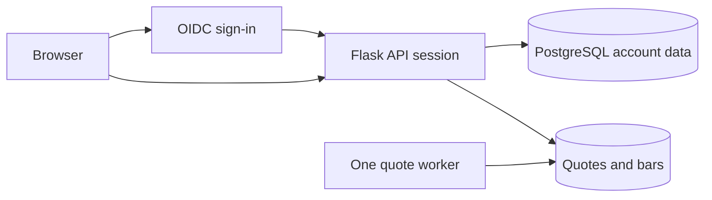

# Public Paperlane architecture

Status: design for a later public release. The Flask server uses local PostgreSQL, OIDC sign-in code, revocable sessions, and one account schema per validated identity. A live Auth0 tenant is not yet configured or tested. The synthetic market and financial ledger still need production work; this is not a public deployment.

## Choices

- **Database:** PostgreSQL with Liquibase migrations. The local setup can use Homebrew PostgreSQL. A managed provider such as Supabase can host a later public database; keep app credentials only on the backend.
- **Identity:** Auth0 Free for initial customer sign-in, through standard OpenID Connect (OIDC). React redirects to hosted sign-in. Flask uses Authlib Authorization Code with PKCE and validates the ID token, state, issuer and nonce. It issues an opaque HttpOnly, SameSite app cookie; `Secure` is enabled for HTTPS deployments. [Authlib Flask guide](https://docs.authlib.org/en/latest/oauth2/client/web/flask.html).
- **Authorization:** The stable `(issuer, subject)` pair maps to a local user ID and an account schema; email is never the account key. Every personal API route resolves the server-side session before selecting that schema. A client-supplied account ID cannot select another ledger. The preserved pre-login ledger requires an explicit owner assignment. A future larger release should move to row-level account ownership and database-enforced policies.
- **Market simulation:** One quote worker owns the synthetic market clock and publishes shared quotes. API workers read that state. The current server's in-memory quote loop and two-second whole-blob database writes must be replaced before horizontal scaling.

## Login sessions and Redis

Auth0 is contacted at sign-in. Normal API requests query a hashed, eight-hour app session in PostgreSQL; they do not call Auth0 each time. Logout revokes the local session, although it does not clear an existing Auth0 single-sign-on session. Disabling a local user blocks their sessions immediately; disabling a user only at Auth0 does not revoke an already issued local session until it expires. Redis can later cache sessions, rate limits or quote data if multiple API instances need it, but PostgreSQL remains the durable source for trades and learning. Redis must never be the source of truth for trades.

## Proposed data model

The proposed row-owned ledger is [backend/schema_public_proposed.sql](backend/schema_public_proposed.sql). It is a review artifact and has **not** been run. It creates a separate private `paperlane_app` schema. The implemented local design currently uses one schema per user, which preserves the existing exchange code but is not the long-term model for many users.

| Table | Key fields | Relationship |
| --- | --- | --- |
| `app_users` | `id UUID`, `oidc_issuer`, `oidc_subject`, `created_at` | Unique `(oidc_issuer, oidc_subject)` |
| `paper_accounts` | `id UUID`, `user_id`, `cash_paise BIGINT`, `realized_pnl_paise BIGINT` | One virtual account per user in v1 |
| `positions` | `account_id`, `instrument_id`, `quantity`, `average_price_paise` | Unique `(account_id, instrument_id)` |
| `orders` | `id UUID`, `account_id`, `instrument_id`, side, type, quantity, limit/trigger, status, reservation | Account-owned; retry key is unique per account |
| `fills` | `id UUID`, `order_id`, `account_id`, quantity, price, fee, time | Immutable execution record; same-account foreign key |
| `account_ledger` | `account_id`, `fill_id`, entry type, signed paise amount | Append-only explanation of cash changes |
| `trade_plans` | `id UUID`, `account_id`, reason, exit rule, budget | Account-owned |
| `learning_progress` | `user_id`, kind, lesson ID, completed time | User-owned |
| `journal_notes` | `id UUID`, `account_id`, text, created time | Account-owned |
| `instruments` | stable instrument ID, exchange, contract metadata | Shared reference data |
| `quotes` / `price_bars` | instrument ID, source, timestamp, price | Shared simulated data |

Use integer paise or a defined `NUMERIC` scale for money in the public ledger. The existing SQLite and transitional PostgreSQL schemas store floating-point numbers to preserve the local prototype; do not treat them as the final financial ledger.

## Request and order flow

For each order, the API derives the account from the validated session, starts a database transaction, locks the account and affected position, checks quantity and virtual margin against the current quote, then writes the order, fill, position and balance together. A retry key prevents duplicate orders. API tests must prove that user A cannot view, cancel, reset or alter user B's records. A dedicated worker processes pending orders against new quotes.

## Launch gates

1. Connect and end-to-end test an Auth0 tenant with a real user, including login, logout, expiry and disabled-account behavior. [Auth0 currently lists a free plan for up to 25,000 monthly active users](https://auth0.com/pricing); verify terms and limits before launch.
2. Migrate the per-user schemas to the row-owned ledger model above with integer paise and database-enforced ownership. Import the preserved local account into **one explicitly chosen user**. Never automatically expose that history to new registrations.
3. Separate quote generation from request workers. Add structured logs, rate limits, backups, restore drills and deployment secrets. Use HTTPS and a deployment that does not expose the database directly to browsers.
4. Resolve market-data licensing and option-settlement accuracy before making real-time or exchange-equivalent claims. The current feed is synthetic.

The public server must remain undeployed until those gates are met. Local authentication and account isolation are an important step, but they do not prove production readiness.
